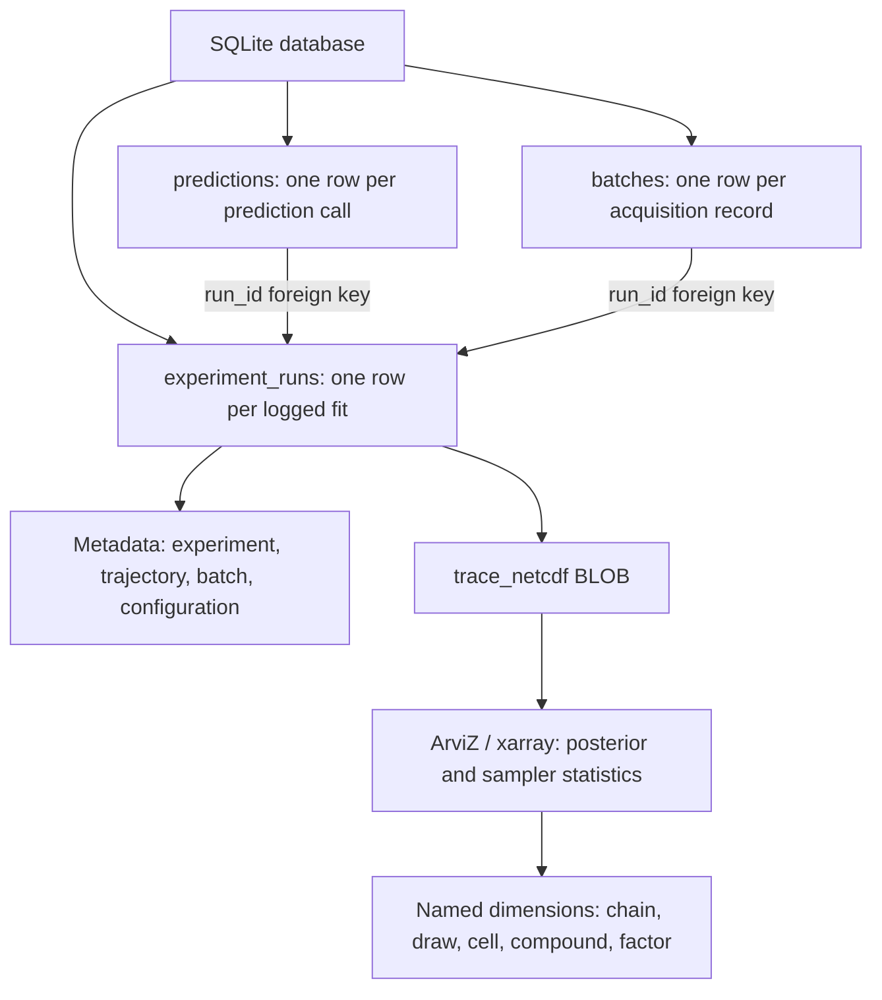

# BATCHIE Experiment Logger

A SQLite writer for artifacts from completed model fits:
- Retained MCMC traces, including all supplied groups, coordinates, and attributes
- Optional prediction calls and selected/revealed acquisition records
- Fit configuration and caller-supplied provenance

Loading a trace helps with post-analysis of the bayesian sampling process.

## Storage design

The logger has separate tables for fits, prediction calls, and acquisition batches to match the structure of experimental artifacts.

