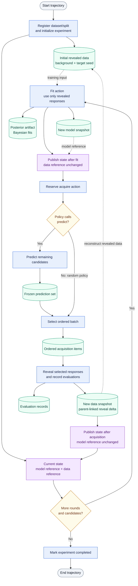

# Adaptive-screen experiment logger

A self-contained SQLite logger for iterative drug screening. The core knows
responses, splits, states, actions, predictions and artifacts. It does not import
Batchie, PyMC, ArviZ, NumPy, pandas, Torch or DSPy. The optional `integration.py`
adapter translates the supplied simulation's DataFrames and Bayesian model.

## What is recorded

An experiment is one trajectory: one split, model family, configuration and
replicate. `name` groups comparable experiments. Dataset and split IDs are
content hashes, so identical inputs are reused within the same database;
experiment and action IDs are UUIDs, so replicates remain distinct.

An experiment state references a model snapshot and a data snapshot. A fit
changes only the model reference; acquisition changes only the data reference.
The newly revealed observations do not retroactively become inputs to the old fit.

| Table | Role |
|---|---|
| `datasets` | Immutable response definition/provenance and measured row count |
| `entities` | Cell and drug axes, with optional tissue/MOA metadata |
| `responses` | Measured cell–drug–dose entries and ground-truth values |
| `splits`, `split_memberships` | Explicit initial/pool/validation/test roles |
| `experiments` | Actual trajectories, configuration, status, current-state pointer |
| `experiment_states` | Ordered pairs of model/data references |
| `data_states`, `reveals` | Parent-linked reveal deltas; initial state includes background |
| `model_states` | Versioned manifest and producing action |
| `actions` | Input/output state, kind, configuration, timing, status and failure |
| `fit_inputs` | Exact input response IDs **and their order**, also usable by reflection |
| `artifacts` | Relative paths, sizes, checksums, roles and format metadata |
| `prediction_sets`, `prediction_values` | Frozen predictions linked to the producing model and data state |
| `acquisitions`, `acquisition_items` | Policy, requested/actual size and ordered selections |
| `evaluations` | Typed scalar results with scope, sample count and definition version |
| `acquisition_errors` (view) | Acquired truth, pre-reveal estimate, residual and uncertainty |
